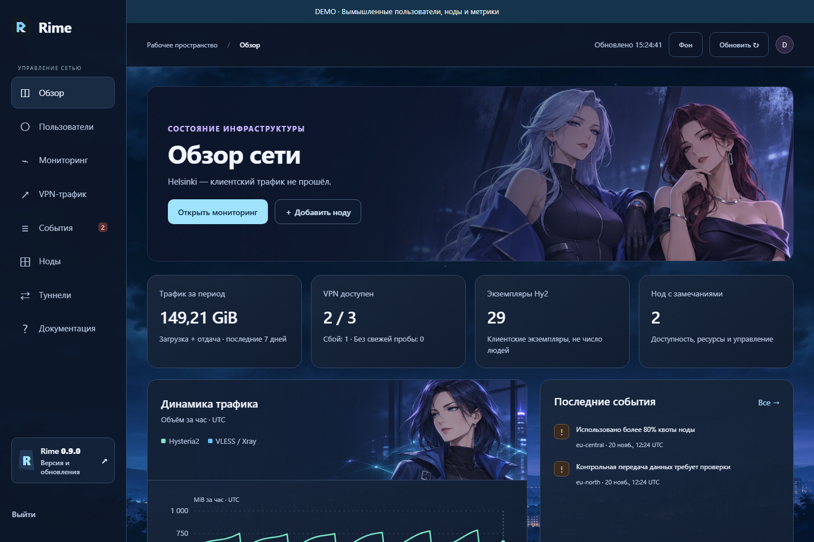
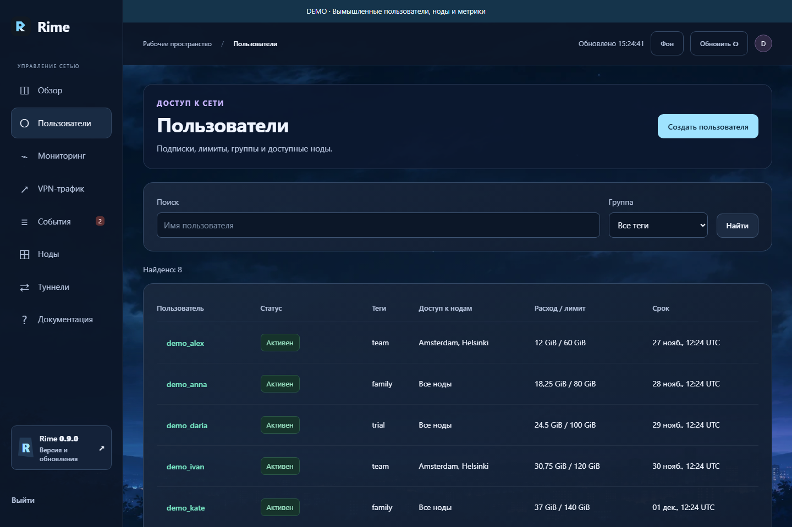
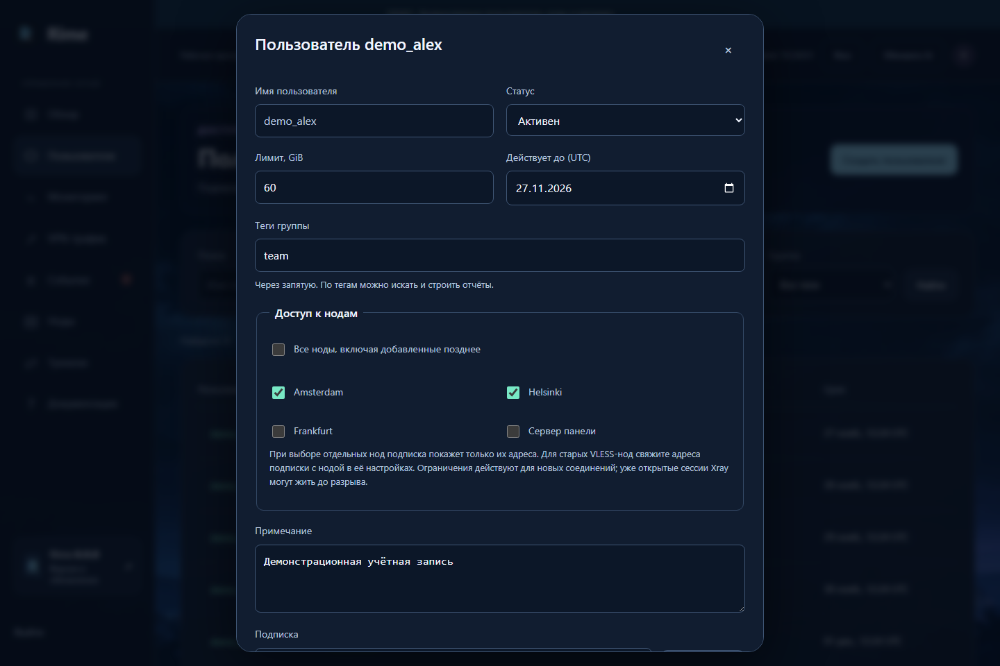
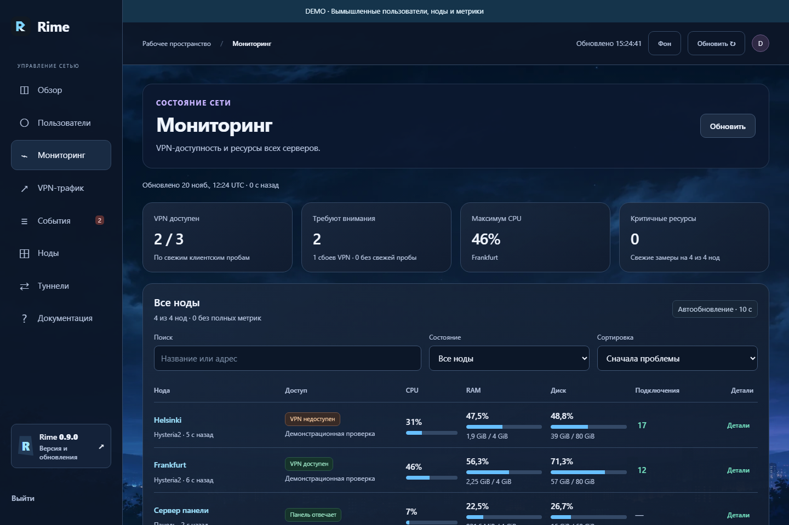
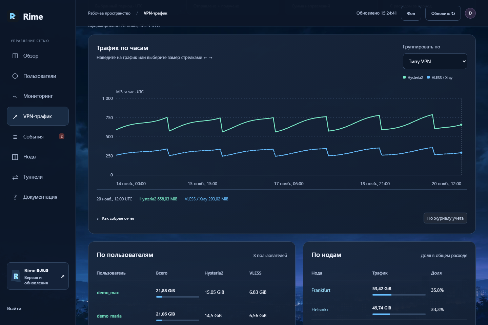
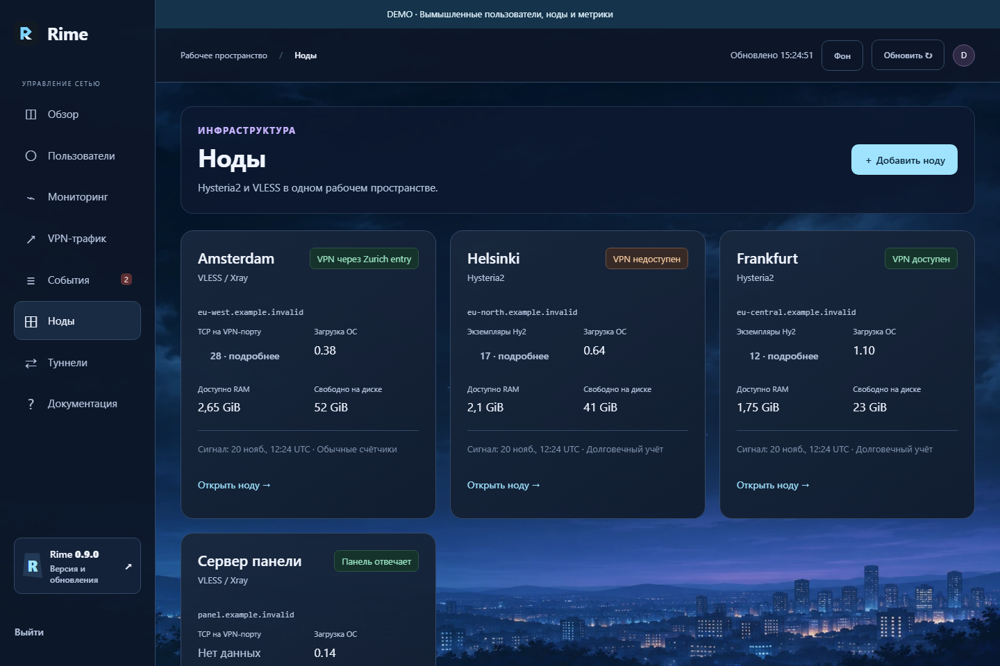
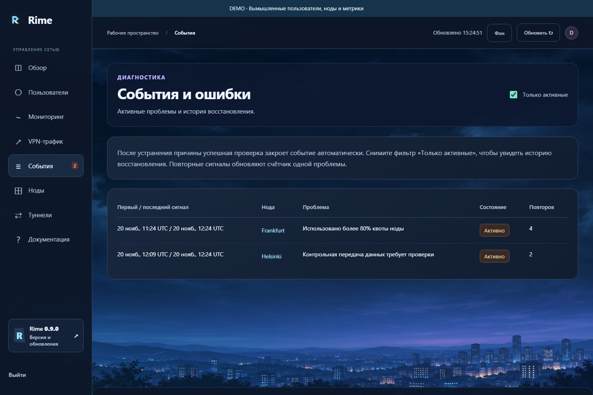
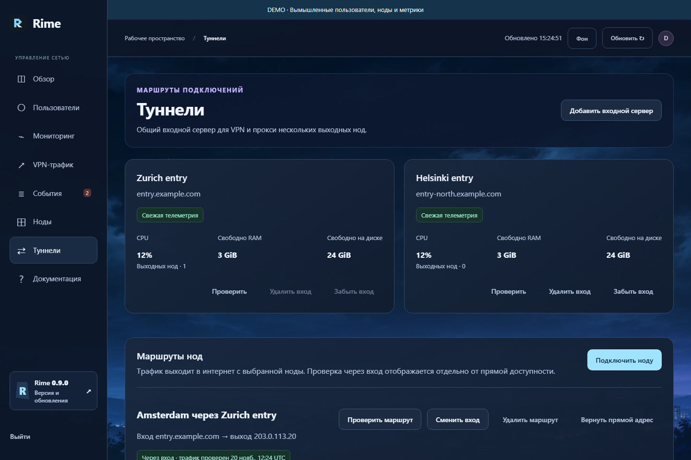
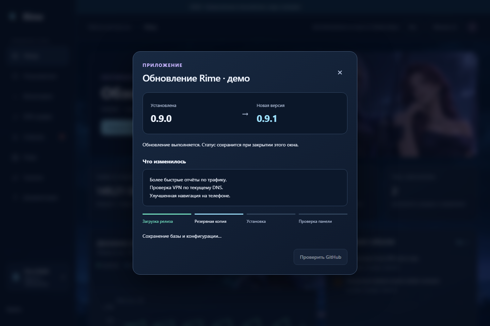
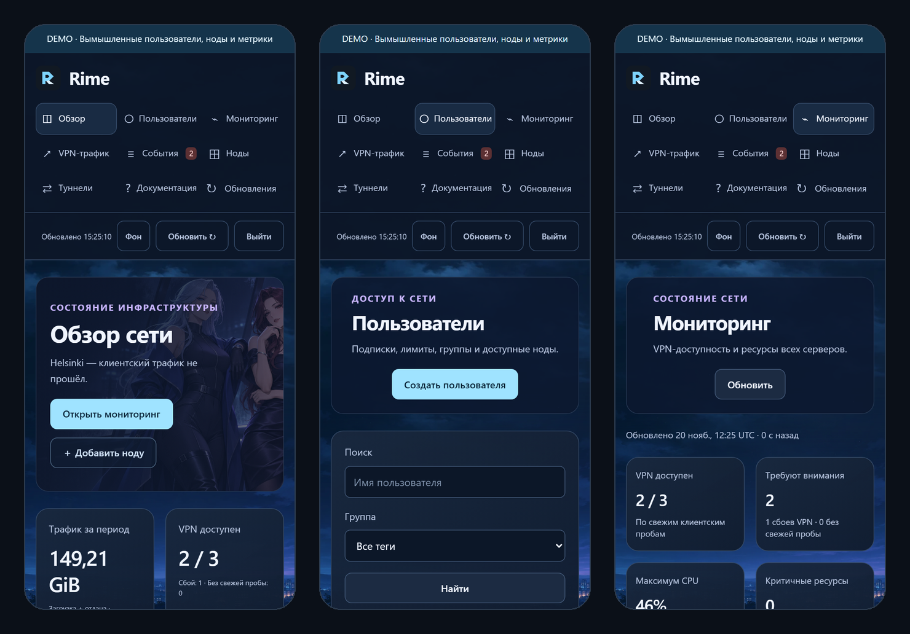

<p align="center">
  
</p>

<h1 align="center">Rime</h1>

<p align="center">
  <b>Единая панель для VPN-флота на VLESS и Hysteria2.</b><br>
  Пользователи, подписки, трафик, состояние серверов, инциденты, развёртывание и подписанные обновления — в одном месте.
</p>

<p align="center">
  
  
  
  
  
</p>

<p align="center">
  <a href="README.md">English</a> · <b>Русский</b>
</p>



<sub>На всех скриншотах настоящий интерфейс Rime на встроенном демо-стенде
(<code>scripts/docs_demo.py</code>). Пользователи, домены, адреса и метрики вымышлены.</sub>

## Зачем Rime

Rime вырос из [Marzban 0.8.4](https://github.com/Gozargah/Marzban) в полноценную панель
эксплуатации для тех, у кого несколько VPN-серверов. Всё, на что опираются пользователи
Marzban, сохранено: API, ссылки подписок, UUID пользователей, каталог `/var/lib/marzban`.
Сверху добавлено то, что нужно растущему флоту.

- **Два протокола, один список.** Ноды VLESS на Xray и Hysteria2 работают рядом: общие
  пользователи, лимиты и отчёты.
- **Клиенты ничего не замечают.** Ссылки подписок и ключи пользователей не меняются при
  обновлениях, переносе нод и смене входного сервера.
- **Проблемы видны раньше, чем их заметят пользователи.** CPU, RAM и диск в реальном времени,
  доступность VPN по клиентским пробам, инциденты с подсказками по восстановлению.
- **Безопасные изменения.** Мастер развёртывания показывает каждое действие заранее, обновления
  подписаны и начинаются с резервной копии, неудачное обновление откатывается само.

## Экскурсия по панели

<table>
  <tr>
    <td width="50%"><a href="docs/screenshots/users.png"></a></td>
    <td width="50%"><a href="docs/screenshots/user-dialog.png"></a></td>
  </tr>
  <tr>
    <td><b>Пользователи.</b> Поиск, теги, статусы, расход относительно лимита и сроки.</td>
    <td><b>Карточка пользователя.</b> Лимит, срок, группы, доступ к отдельным нодам и ссылка подписки.</td>
  </tr>
  <tr>
    <td><a href="docs/screenshots/monitoring.png"></a></td>
    <td><a href="docs/screenshots/traffic.png"></a></td>
  </tr>
  <tr>
    <td><b>Мониторинг.</b> Все серверы в одной таблице: доступность VPN, CPU, RAM, диск и сессии.</td>
    <td><b>VPN-трафик.</b> Почасовые графики по протоколам, нодам, группам и пользователям, выгрузка CSV.</td>
  </tr>
  <tr>
    <td><a href="docs/screenshots/nodes.png"></a></td>
    <td><a href="docs/screenshots/events.png"></a></td>
  </tr>
  <tr>
    <td><b>Ноды.</b> Список серверов, история ресурсов, квоты трафика и мастер развёртывания.</td>
    <td><b>События.</b> Инциденты с подтверждением, комментариями и автоматическим восстановлением.</td>
  </tr>
  <tr>
    <td><a href="docs/screenshots/relays.png"></a></td>
    <td><a href="docs/screenshots/update-progress.png"></a></td>
  </tr>
  <tr>
    <td><b>Туннели (предварительная версия).</b> Выходные ноды за общим входным сервером, проверка каждого маршрута.</td>
    <td><b>Обновления.</b> Описание релиза, резервная копия, установка и проверка в одном окне.</td>
  </tr>
</table>

Панель удобна и с телефона:



Остальные экраны и порядок съёмки — в [галерее скриншотов](docs/SCREENSHOTS.md).

## Возможности

| Раздел | Что умеет |
|---|---|
| **Пользователи и доступ** | Учётные записи с лимитами трафика, сроками и статусами. Теги объединяют пользователей для поиска и отчётов. Доступ — ко всем нодам или к выбранным. Ранее выданные ссылки подписок остаются рабочими. |
| **Трафик** | Общий учёт Xray и Hysteria2, почасовая история, фильтры по пользователю, тегу, ноде и протоколу, выгрузка CSV. С проверенных native-нод счётчики читаются накопительно, поэтому потерянный ответ или повтор не спишет трафик дважды. |
| **Мониторинг** | CPU, RAM, диск, аптайм и подключения каждой ноды, история доступности за семь дней, отдельная карточка сервера панели. Проверка VPN гоняет настоящий клиентский трафик, а не просто стучится в порт. |
| **Инциденты** | Одна запись на сбой со счётчиком повторов, комментариями администратора и подсказками. После успешной повторной проверки инцидент закрывается сам. |
| **Работа с нодами** | Установка по SSH с полным предпросмотром, квоты трафика на ноду, комплект восстановления, перенос ноды на новый сервер и удаление с точным списком последствий. |
| **Прокси и туннели** | Управляемые HTTP/HTTPS-прокси на нодах. Входные серверы публикуют несколько выходных нод под одним адресом; эта часть в предварительной версии. |
| **Обновления** | Обновление в один клик из GitHub Releases. Манифесты подписаны Ed25519, данные сначала копируются, неудачная версия откатывается автоматически. |
| **Безопасность** | Xray API хаба доступен только через приватный Unix-сокет. Генерируемые конфигурации блокируют приватные и loopback-адреса. Сертификаты native-нод закрепляются, а их управляющие порты можно ограничить панелью и входными серверами. |
| **Встроенная справка** | Инструкции для администратора и FAQ прямо в панели, раздел **Документация**. |

## Быстрый старт

Нужен Linux-сервер с Docker и плагином Compose. Rime использует SQLite и работает
одним процессом панели.

**1. Скачайте исходники и подготовьте каталог данных.**

```sh
git clone https://github.com/MaksimSamarin/rime.git
cd rime
sudo mkdir -p /var/lib/marzban
sudo cp xray_config.json /var/lib/marzban/
cp .env.example .env
```

**2. Храните базу и конфигурацию Xray на хосте.** Добавьте в `.env`:

```ini
SQLALCHEMY_DATABASE_URL = "sqlite:////var/lib/marzban/db.sqlite3"
XRAY_JSON = "/var/lib/marzban/xray_config.json"
```

Для доступа из интернета задайте также `UVICORN_SSL_CERTFILE` и `UVICORN_SSL_KEYFILE`
(или поставьте панель за обратный прокси). В `XRAY_SUBSCRIPTION_URL_PREFIX` укажите
публичный адрес панели. Остальные настройки из `.env.example` необязательны.

**3. Соберите, запустите и создайте первого администратора.**

```sh
docker compose up -d --build
docker compose exec rime python rime-cli.py admin create --sudo
```

Команда спросит логин и пароль. Вопросы про Telegram и Discord пропустите клавишей Enter.

**4. Откройте панель** по адресу `https://<ваш-домен>:8000/fleet`. Без TLS-сертификатов
панель слушает только `127.0.0.1`. Тогда подключитесь через SSH:

```sh
ssh -L 8000:localhost:8000 user@your-server
```

И откройте <http://127.0.0.1:8000/fleet>.

### Готовый образ

В каждом [релизе на GitHub](https://github.com/MaksimSamarin/rime/releases) есть собранный
образ для Linux amd64. Скачайте `rime-linux-amd64.tar.gz` и `SHA256SUMS` в каталог
с исходниками и выполните вместо сборки из шага 3:

```sh
sha256sum -c SHA256SUMS
docker load -i rime-linux-amd64.tar.gz
docker tag rime:0.9.4 rime:current
docker compose up -d
```

## Обновление

**Из панели.** Один раз установите службу обновления на хост, находясь в каталоге
с `docker-compose.yml`:

```sh
sudo python3 scripts/install_updater.py
```

Установщик сам найдёт запущенный сервис `rime`. Если панель запущена без Compose,
укажите имя контейнера через `--container <имя>`. После этого кнопка версии в боковом меню
проверяет GitHub, показывает описание релиза, делает резервную копию и ставит обновление.
Служба принимает только релизы, подписанные ключом Rime. Подробности — в [docs/UPDATES.md](docs/UPDATES.md).

**С Marzban или ранней сборки Rime.** Сохраните `/var/lib/marzban`, ключи подписи, UUID
пользователей и согласованную резервную копию базы. Миграции базы выполняются при запуске
автоматически. Перед переводом рабочего трафика пройдите [docs/OPERATIONS.md](docs/OPERATIONS.md).

## Документация

Подробные руководства написаны на английском.

| Руководство | О чём |
|---|---|
| [Консоль](docs/CONSOLE.md) | Разделы панели, правила доступа, работа с инцидентами, ограничения мониторинга |
| [Эксплуатация и миграция](docs/OPERATIONS.md) | Настройка, защита хаба, мастер развёртывания, перенос нод |
| [Обновления](docs/UPDATES.md) | Служба обновления, резервные копии, откат, подпись релизов |
| [Безопасность нод](docs/NATIVE-SECURITY.md) | Закрепление сертификатов и ограничение источников управления |
| [Квоты нод](docs/NODE_QUOTAS.md) и [жизненный цикл](docs/NODE_LIFECYCLE.md) | Лимиты трафика на ноду, добавление и удаление нод |
| [Туннели](docs/TUNNELS.md) | Входные серверы, проверка маршрутов, смена входа (предварительная версия) |
| [Сборщики ресурсов](docs/RESOURCE_OBSERVERS.md) и [смысл метрик](docs/TRAFFIC_AND_CONNECTIONS.md) | Что означает каждая метрика и откуда она берётся |
| [Проверки](docs/TESTING.md) | Закрытые приёмочные проверки релизов |
| [CLI](cli/README.md) и [участие в проекте](CONTRIBUTING.md) | Командная строка и порядок отправки изменений |
| [Что нового в 0.9.4](docs/RELEASE-0.9.4.md), [в 0.9.3](docs/RELEASE-0.9.3.md), [в 0.9.2](docs/RELEASE-0.9.2.md), [в 0.9.1](docs/RELEASE-0.9.1.md) и [в 0.9.0](docs/RELEASE-0.9.0.md) | Изменения последних версий |

## Ограничения

- Только SQLite и один процесс панели. MySQL и несколько процессов контроллера не поддерживаются.
- Для развёртывания нужны разрешённый SSH-сервер, Docker и ваши TLS-сертификаты. Rime не покупает
  серверы, не создаёт DNS-записи и не выпускает сертификаты.
- Квоты проверяются опросом и могут быть немного превышены. История начинается с момента запуска сбора.
- Новые ссылки Hysteria2 публикуются в подписках-списках ссылок, не во всех форматах клиентов.
- Удаление ноды в панели не стирает удалённый сервер, DNS-записи и резервные копии.

## Проект и лицензия

Rime основан на [Marzban 0.8.4](https://github.com/Gozargah/Marzban),
[Xray](https://github.com/XTLS/Xray-core) и [Hysteria](https://github.com/apernet/hysteria).
Распространяется по лицензии [AGPL-3.0](LICENSE); исходные уведомления и история сохранены.
См. [NOTICE](NOTICE.md) и [происхождение кода](docs/upstream/README.md).
Имена совместимости вроде `marzban-cli.py` и `/var/lib/marzban` оставлены для миграции и не
означают одобрения исходным проектом. Rime Input Method Engine — другой, не связанный проект.
