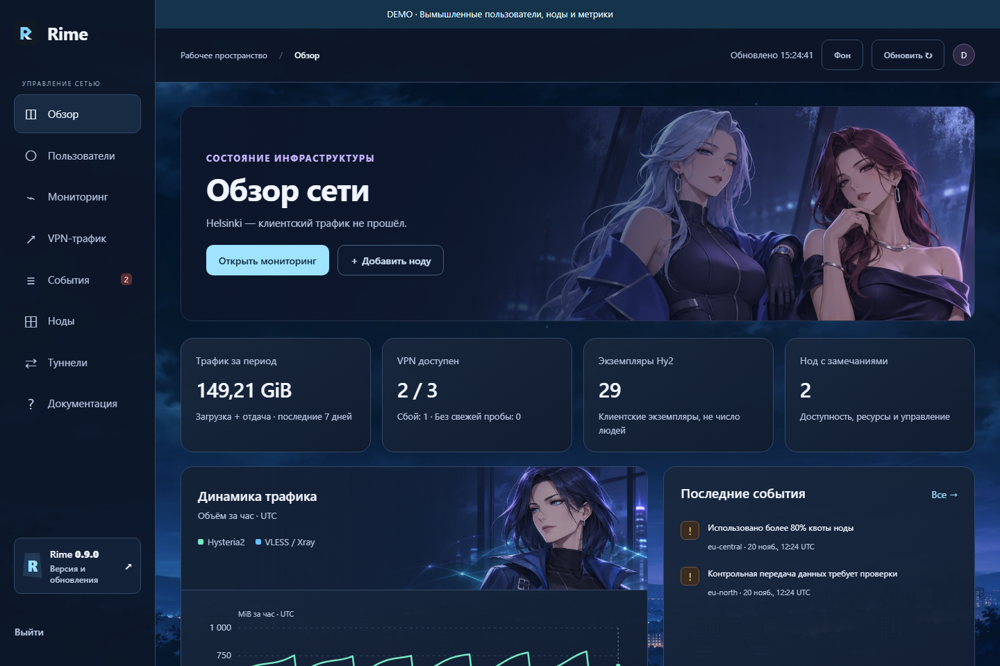
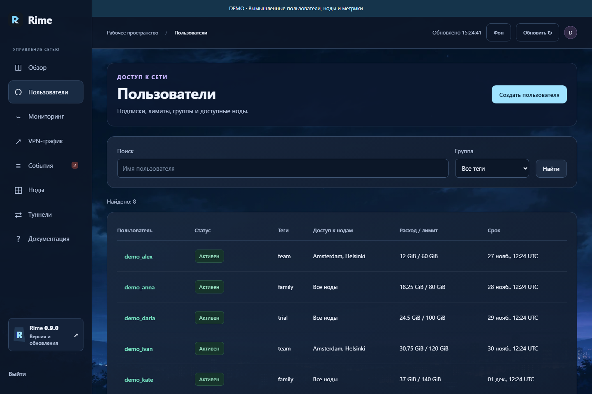
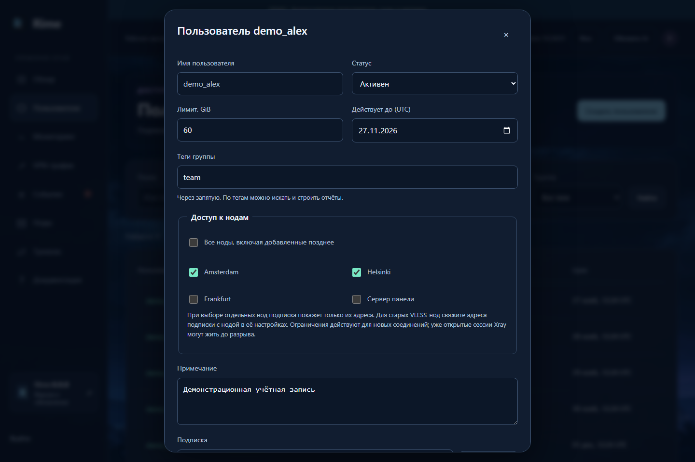
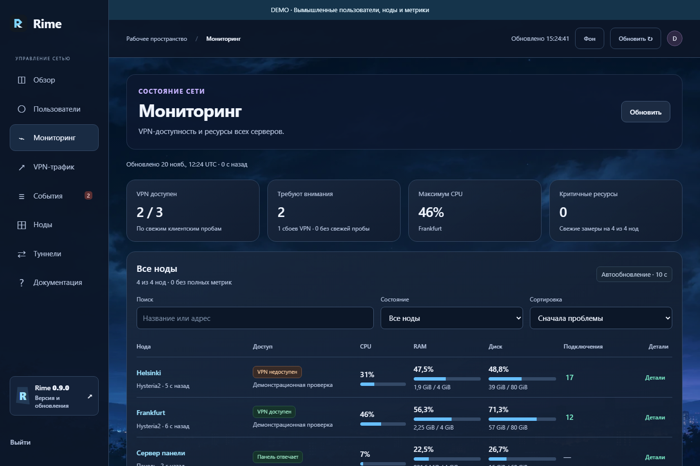
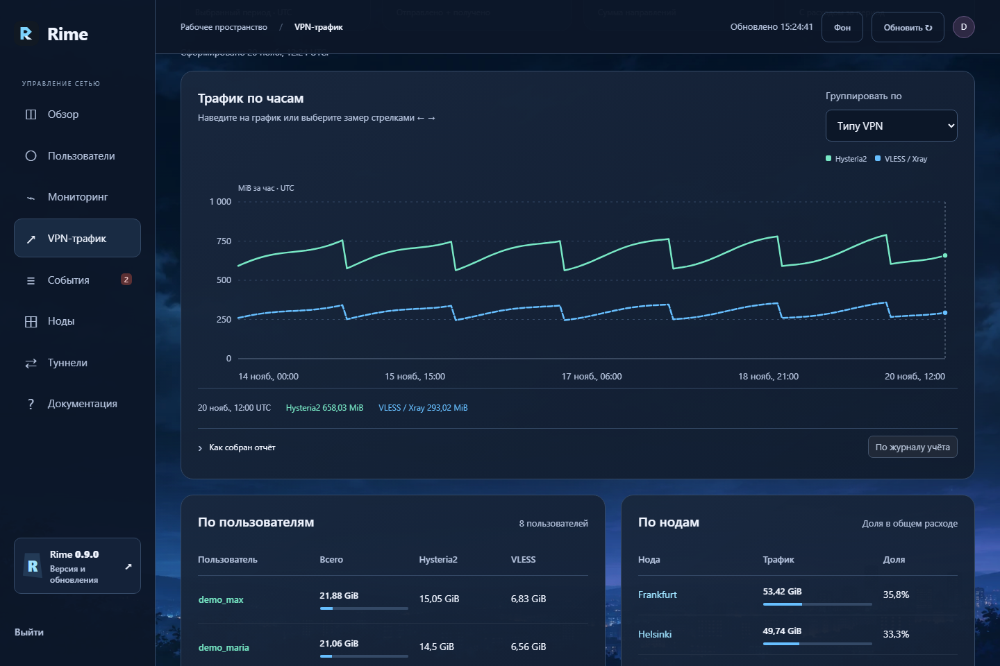
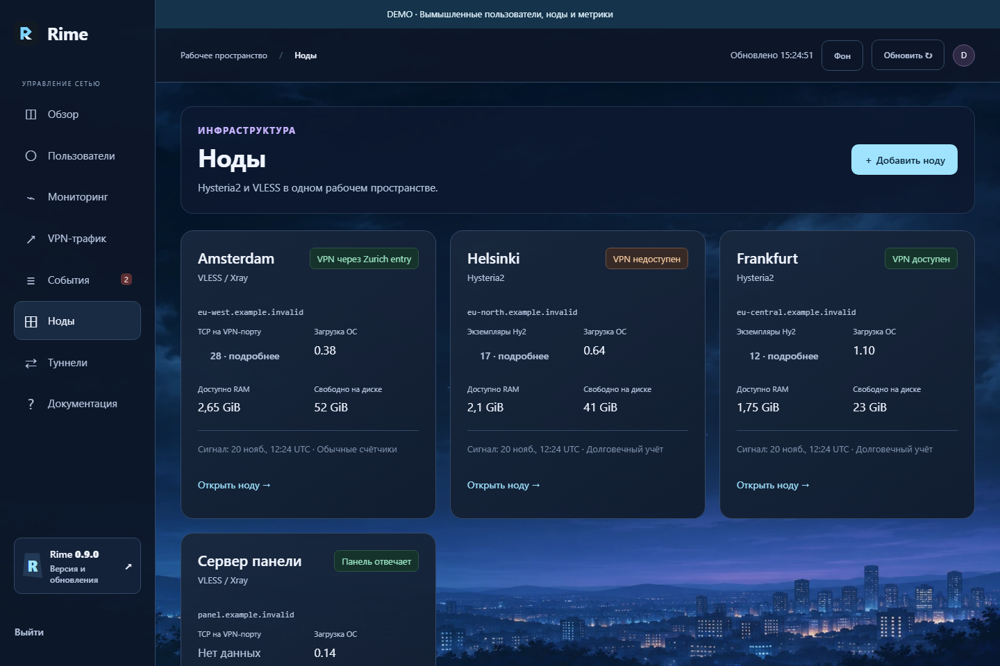
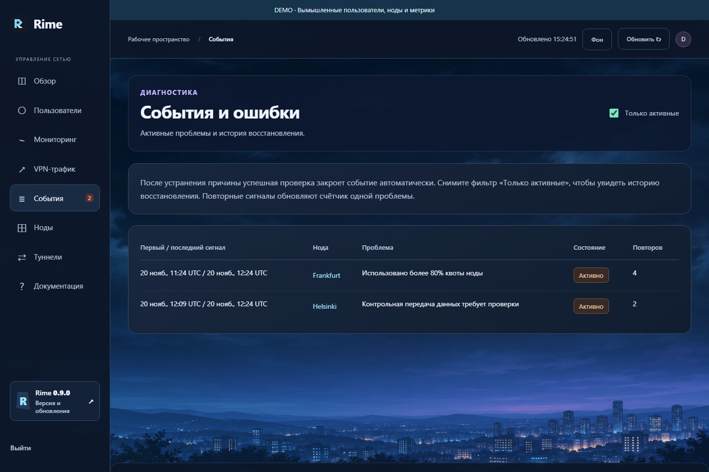
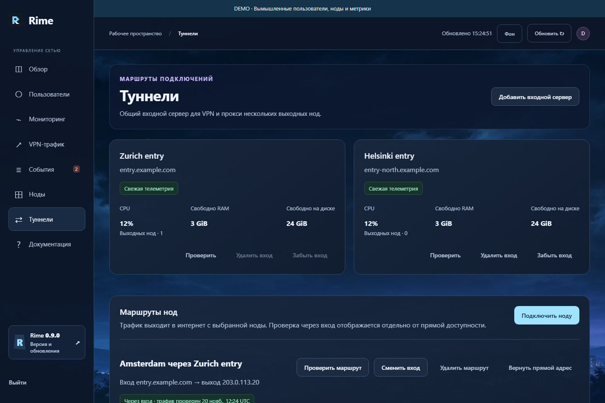
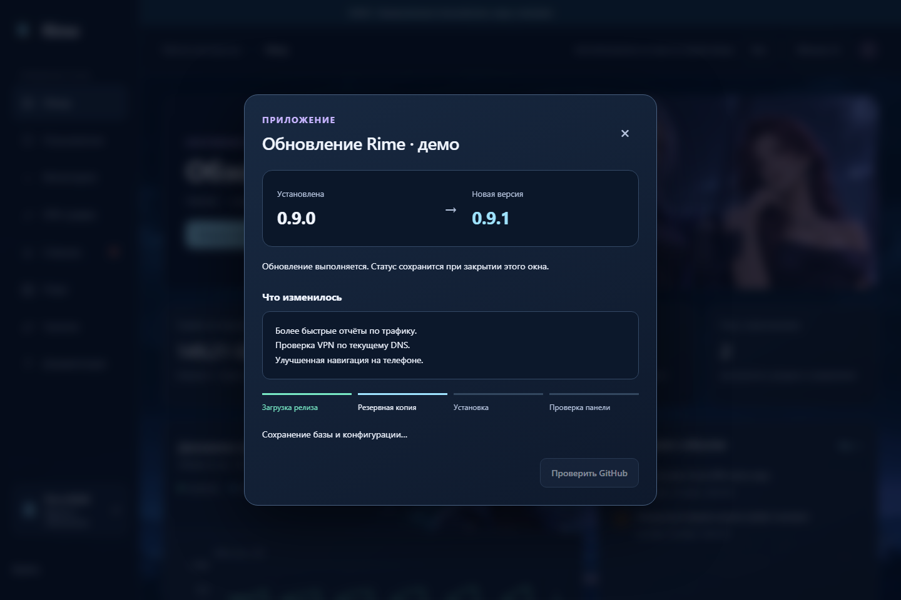
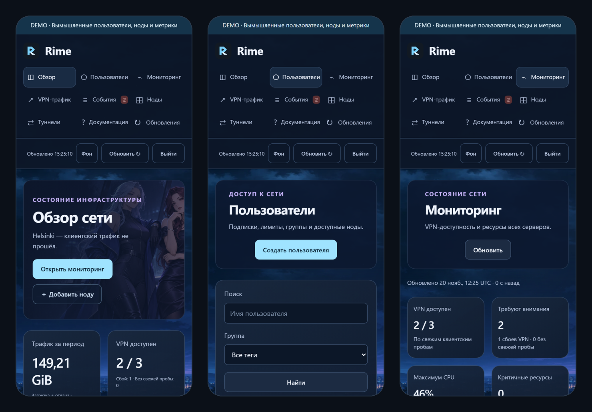

<p align="center">
  
</p>

<h1 align="center">Rime</h1>

<p align="center">
  <b>One console for a VLESS and Hysteria2 VPN fleet.</b><br>
  Users, subscriptions, traffic, server health, incidents, deployment and signed updates in one place.
</p>

<p align="center">
  
  
  
  
  
</p>

<p align="center">
  <b>English</b> · <a href="README-ru.md">Русский</a>
</p>



<sub>All screenshots show the real Rime interface running on the built-in synthetic demo
(<code>scripts/docs_demo.py</code>). Every user, domain, address and metric is fictional.
The console interface is in Russian.</sub>

## Why Rime

Rime grew out of [Marzban 0.8.4](https://github.com/Gozargah/Marzban) into a full operations console
for people who run several VPN servers. It keeps everything Marzban users rely on (the API,
subscription URLs, user UUIDs, `/var/lib/marzban`) and adds the parts a growing fleet needs.

- **Two protocols, one inventory.** VLESS on Xray and Hysteria2 nodes live side by side with
  shared users, limits and reports.
- **Nothing breaks for clients.** Subscription URLs and user keys stay valid across updates, node
  moves and entry-server changes.
- **See problems before users do.** Live CPU, RAM and disk data, VPN availability from client-side
  probes, and incidents with recovery guidance.
- **Safe changes.** The deployment wizard previews every change, updates are signed and back up
  data first, and a failed update rolls back automatically.

## A tour of the console

<table>
  <tr>
    <td width="50%"><a href="docs/screenshots/users.png"></a></td>
    <td width="50%"><a href="docs/screenshots/user-dialog.png"></a></td>
  </tr>
  <tr>
    <td><b>Users.</b> Search, tags, statuses, usage against limits and expiry dates.</td>
    <td><b>User editor.</b> Limits, expiry, groups and per-node access, with the subscription link.</td>
  </tr>
  <tr>
    <td><a href="docs/screenshots/monitoring.png"></a></td>
    <td><a href="docs/screenshots/traffic.png"></a></td>
  </tr>
  <tr>
    <td><b>Monitoring.</b> Every server in one table: VPN availability, CPU, RAM, disk and sessions.</td>
    <td><b>VPN traffic.</b> Hourly charts by protocol, node, group and user, with CSV export.</td>
  </tr>
  <tr>
    <td><a href="docs/screenshots/nodes.png"></a></td>
    <td><a href="docs/screenshots/events.png"></a></td>
  </tr>
  <tr>
    <td><b>Nodes.</b> Inventory, resource history, node traffic quotas and the deployment wizard.</td>
    <td><b>Events.</b> Incidents with acknowledgement, comments and automatic recovery.</td>
  </tr>
  <tr>
    <td><a href="docs/screenshots/relays.png"></a></td>
    <td><a href="docs/screenshots/update-progress.png"></a></td>
  </tr>
  <tr>
    <td><b>Tunnels (preview).</b> Publish exit nodes through a shared entry server and check each route.</td>
    <td><b>Updates.</b> Release notes, backup, installation and verification in one dialog.</td>
  </tr>
</table>

The console also works on a phone:



More screens and how they are produced: [screenshot gallery](docs/SCREENSHOTS.md).

## Features

| Area | What you get |
|---|---|
| **Users and access** | Accounts with data limits, expiry and statuses. Tags group users for search and reports. Access can cover all nodes or a selected set. Previously issued subscription URLs stay valid. |
| **Traffic** | Combined Xray and Hysteria2 accounting, hourly history, filters by user, tag, node and protocol, and CSV export. Qualified native nodes are read from cumulative counters, so a lost reply or retry never charges traffic twice. |
| **Monitoring** | CPU, RAM, disk, uptime and connection details for every node, a seven-day availability history and the panel host shown separately. VPN checks pass real client traffic, not just a port ping. |
| **Incidents** | One record per fault with a confirmation count, administrator comments and recovery guidance. Recovered probes close incidents automatically. |
| **Node operations** | SSH deployment with a full preview, traffic quotas per node, a recovery kit, moving a node to a new server and removal with an exact list of affected data. |
| **Proxies and tunnels** | Managed HTTP/HTTPS proxies on nodes. Entry servers can publish several exit nodes behind one address; this part is a preview. |
| **Updates** | One-click updates from GitHub Releases. Manifests are signed with Ed25519, data is backed up first and a failed candidate is rolled back automatically. |
| **Security** | The hub's Xray API is reachable only through a private Unix socket. Generated configurations block private and loopback destinations. Native node certificates are pinned, and their management ports can be limited to the panel and its entry servers. |
| **Built-in help** | Administrator guides and FAQ inside the console under **Документация**. |

## Quick start

You need a Linux server with Docker and the Compose plugin. Rime uses SQLite and runs
as a single panel process.

**1. Get the source and prepare the data directory.**

```sh
git clone https://github.com/MaksimSamarin/rime.git
cd rime
sudo mkdir -p /var/lib/marzban
sudo cp xray_config.json /var/lib/marzban/
cp .env.example .env
```

**2. Keep the database and Xray configuration on the host.** Add these lines to `.env`:

```ini
SQLALCHEMY_DATABASE_URL = "sqlite:////var/lib/marzban/db.sqlite3"
XRAY_JSON = "/var/lib/marzban/xray_config.json"
```

For access over the internet, also set `UVICORN_SSL_CERTFILE` and `UVICORN_SSL_KEYFILE`
(or put the panel behind a reverse proxy). Set `XRAY_SUBSCRIPTION_URL_PREFIX` to the
public address of the panel. All other settings in `.env.example` are optional.

**3. Build, start and create the first administrator.**

```sh
docker compose up -d --build
docker compose exec rime python rime-cli.py admin create --sudo
```

The command asks for a username and password. Press Enter to skip the Telegram and
Discord questions.

**4. Open the console** at `https://<your-domain>:8000/fleet`. Without TLS certificates the
panel listens only on `127.0.0.1`. In that case, connect through SSH:

```sh
ssh -L 8000:localhost:8000 user@your-server
```

Then open <http://127.0.0.1:8000/fleet>.

### Prebuilt image

Each [GitHub Release](https://github.com/MaksimSamarin/rime/releases) contains a ready
image for Linux amd64. Download `rime-linux-amd64.tar.gz` and `SHA256SUMS` into the
cloned directory and use them instead of `--build` in step 3:

```sh
sha256sum -c SHA256SUMS
docker load -i rime-linux-amd64.tar.gz
docker tag rime:0.9.4 rime:current
docker compose up -d
```

## Updating

**From the panel.** Install the host update service once, from the directory with
`docker-compose.yml`:

```sh
sudo python3 scripts/install_updater.py
```

The installer finds the running `rime` service. If the panel was started without
Compose, pass its container name with `--container <name>`. After that, the version button in the sidebar
checks GitHub, shows release notes, makes a backup and installs the update. The update
service accepts only releases signed with the Rime key. Details are in [docs/UPDATES.md](docs/UPDATES.md).

**From Marzban or an earlier Rime build.** Keep `/var/lib/marzban`, the signing keys, user
UUIDs and a consistent database backup. Database migrations run automatically at start.
Follow [docs/OPERATIONS.md](docs/OPERATIONS.md) before switching live traffic.

## Documentation

| Guide | Contents |
|---|---|
| [Console](docs/CONSOLE.md) | Pages, user access rules, incident workflow and monitoring limits |
| [Operations and migration](docs/OPERATIONS.md) | Configuration, hub protection, deployment wizard and moving nodes |
| [Updates](docs/UPDATES.md) | Host update service, backups, rollback and release signing |
| [Node security](docs/NATIVE-SECURITY.md) | Certificate pinning and management source restrictions |
| [Node quotas](docs/NODE_QUOTAS.md) and [lifecycle](docs/NODE_LIFECYCLE.md) | Traffic limits per node, adding and removing nodes |
| [Tunnels](docs/TUNNELS.md) | Entry servers, route checks and switching entries (preview) |
| [Resource observers](docs/RESOURCE_OBSERVERS.md) and [traffic semantics](docs/TRAFFIC_AND_CONNECTIONS.md) | What each metric means and where it comes from |
| [Testing](docs/TESTING.md) | Closed acceptance checks used for releases |
| [CLI](cli/README.md) and [contributing](CONTRIBUTING.md) | Command-line tools and how to send changes |
| [Release notes 0.9.4](docs/RELEASE-0.9.4.md), [0.9.3](docs/RELEASE-0.9.3.md), [0.9.2](docs/RELEASE-0.9.2.md), [0.9.1](docs/RELEASE-0.9.1.md) and [0.9.0](docs/RELEASE-0.9.0.md) | What changed in recent versions |

## Limits

- SQLite and one panel process only. MySQL and multiple controller workers are not supported.
- Deployment needs an approved SSH target, Docker and TLS certificates you supply. Rime does not
  buy servers, create DNS records or issue certificates.
- Quotas are checked by polling and can be slightly exceeded. History starts when collection starts.
- New Hysteria2 links are published in link-list subscriptions, not in every client format.
- Deleting a node in the panel does not erase the remote server, DNS records or backups.

## Project and license

Rime is based on [Marzban 0.8.4](https://github.com/Gozargah/Marzban),
[Xray](https://github.com/XTLS/Xray-core) and [Hysteria](https://github.com/apernet/hysteria).
It is distributed under the [AGPL-3.0 license](LICENSE); the original notices and history are
preserved. See [NOTICE](NOTICE.md) and [upstream provenance](docs/upstream/README.md).
Compatibility names such as `marzban-cli.py` and `/var/lib/marzban` are kept for migrations; they do
not mean endorsement by the upstream project. Rime Input Method Engine is an unrelated project.
