# Rime interface gallery

These are browser captures of the current `hy2bridge/web` interface. The API
responses come from `scripts/docs_demo.py`, a loopback-only fixture
server. Every account, domain, limit, connection count and metric is synthetic.
No production database, environment file, private key or subscription is loaded.
The example domains and addresses use reserved documentation ranges and cannot be
real VPN endpoints.

## Sign-in

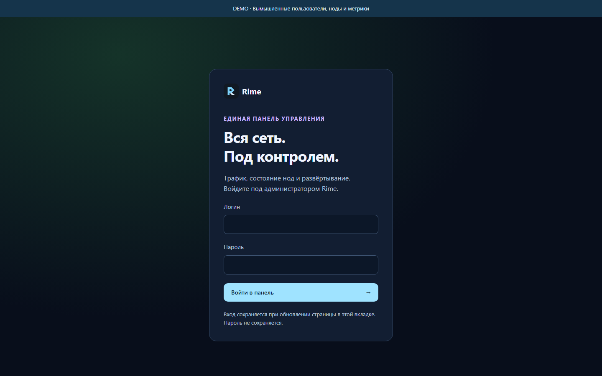

## Overview

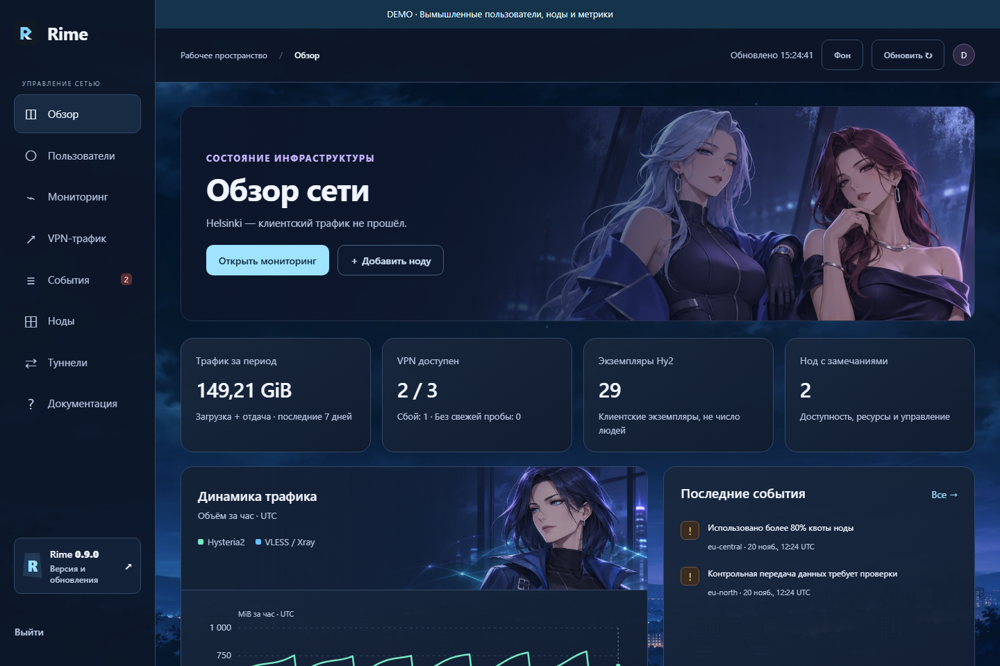

## Users, groups and access

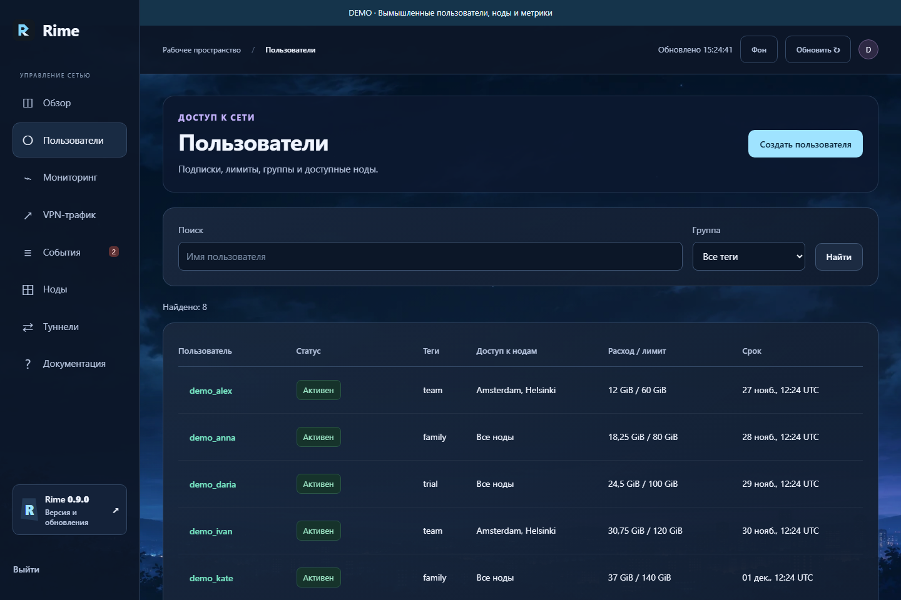

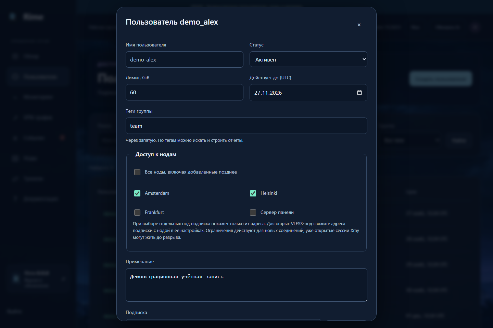

## Resource monitoring

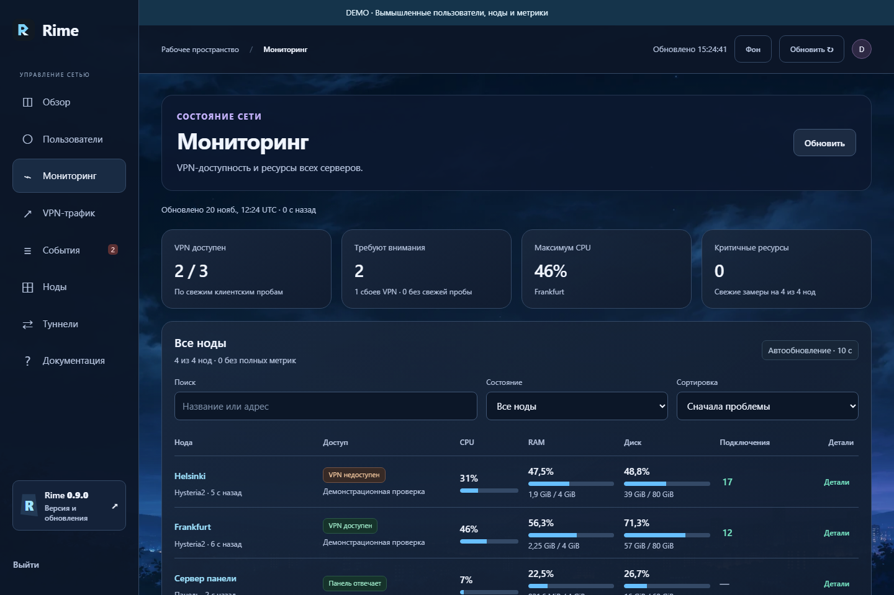

## Traffic reports

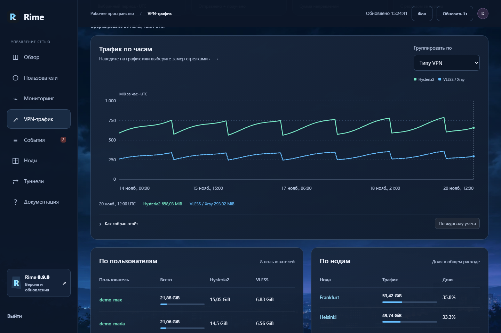

## Nodes

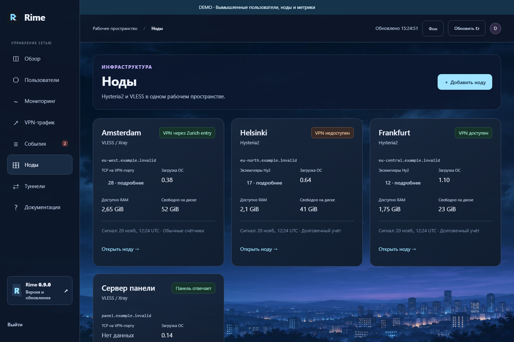

## Incidents

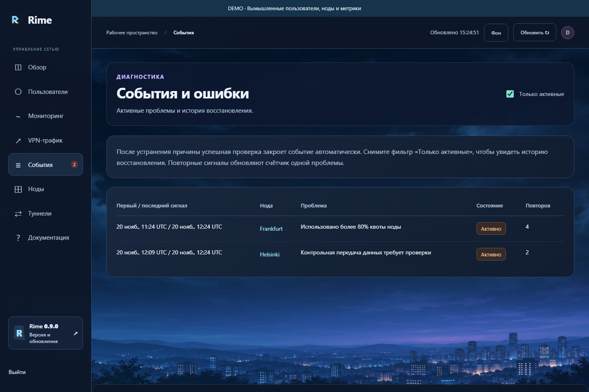

## Explicit tunnels

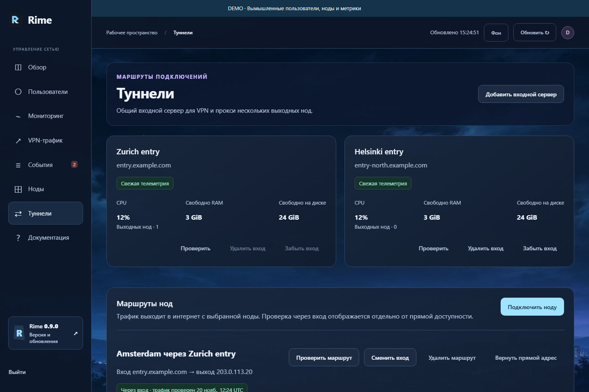

## Release updates

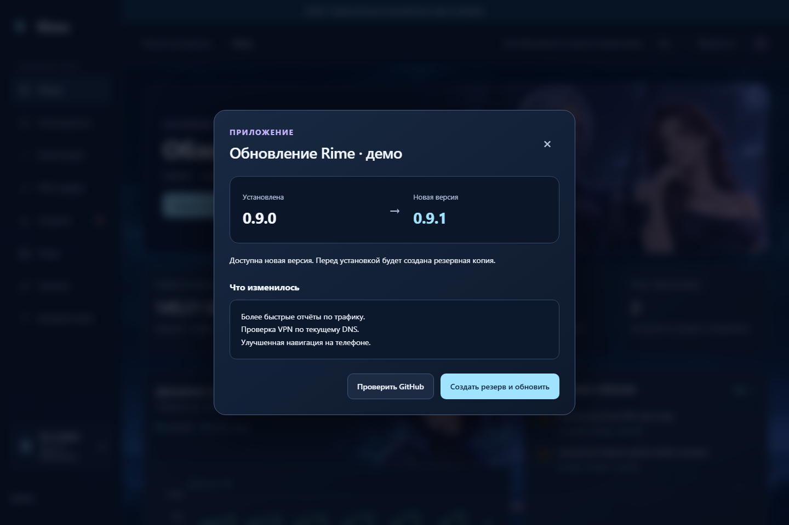

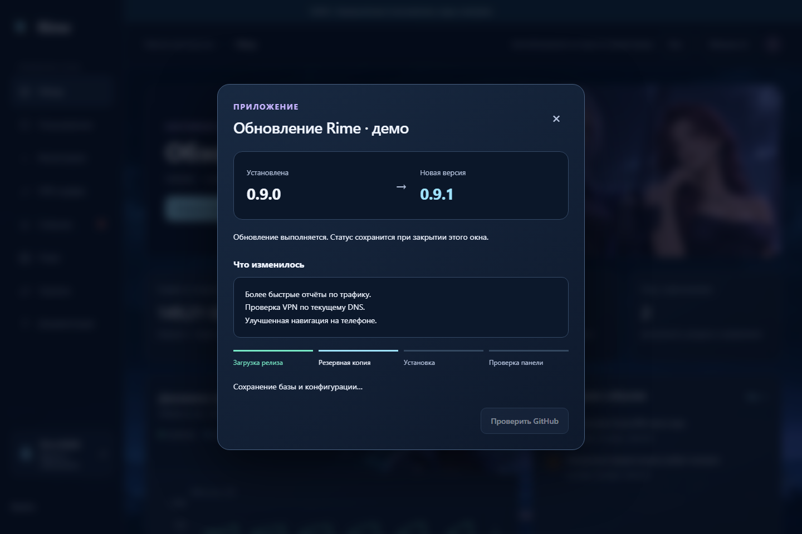

## Built-in documentation

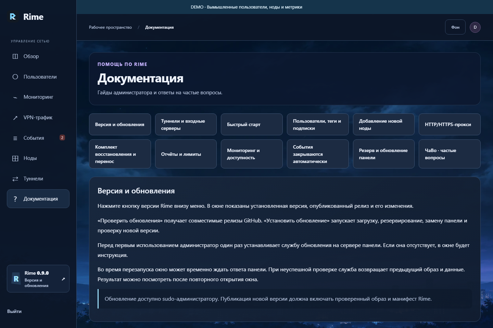

## Phone layout

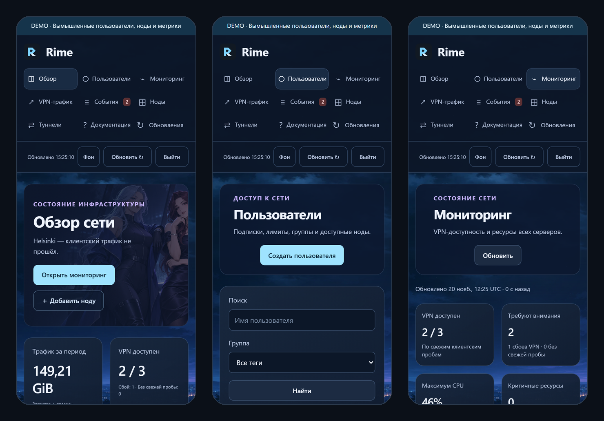

## Reproduce

```sh
python scripts/docs_demo.py --port 18808
```

Open `http://127.0.0.1:18808/fleet`. The demo login accepts `demo` / `demo` (or any
nonempty values); it creates no real session or account. Demonstration actions
change only in-memory fixtures; restart the helper to reset them. The helper does
not start VPN services or make outbound requests. Stop it with Ctrl+C after
capturing. The fixture is for UI examples, not a deployable panel or evidence of
live network performance.

Desktop captures use a 1440×960 browser viewport (the sign-in screen 1440×900).
The traffic capture scrolls to the hourly chart. The update captures open the
version button, choose **Проверить GitHub** and then start the demonstration update.
The phone image combines 390×844 captures at device scale factor 2.

Keep the demonstration label or the surrounding gallery caption. Check each output
before publication for real domains, usernames, tokens, IP addresses and
workstation paths, and strip image metadata.
